<!-- Profile repo: https://github.com/abubakar-maqsood/abubakar-maqsood -->
<div align="center">
  
  <br/><br/>
  <a href="https://www.linkedin.com/in/abu-ba-kar/"></a>
  <a href="https://ayhanpk.com/"></a>
  <a href="https://github.com/abubakar-maqsood?tab=repositories"></a>
</div>

## About me


I'm **Muhammad Abubakar Maqsood**, a software developer focused on **frontend development, Shopify, and SEO**, with a growing interest in **applied AI and computer science research**. I like turning practical problems into thoughtful interfaces and usable digital products.

**What I build**  
Responsive websites, e-commerce experiences, and software prototypes that simplify real workflows.

**Current projects**  
Developing and refining software ideas while exploring research questions in artificial intelligence and computer science.

**Current activities**  
Participating in AI-focused hackathons and technical competitions, experimenting with new tools, and documenting what I learn.

**Experience**  
Web development and e-commerce work with **Fusion Funky**, alongside independent projects.

**Education**  
BS Information Technology, **University of Agriculture Faisalabad**, Sub-Campus Burewala (2025).

**Interested in**  
Software engineering, applied AI, open-source collaboration, and meaningful product development.

<br clear="right" />

## Tools and technologies

### Core focus

**Frontend:** HTML · CSS · JavaScript · Bootstrap · Tailwind CSS  
**Commerce:** Shopify · Liquid · E-commerce workflows  
**Web quality:** SEO · Responsive design · Performance · Accessibility  
**Everyday tools:** Git · GitHub · VS Code · Debugging

<div align="left">
  
</div>

### Currently exploring

These are **learning areas and technologies I'm experimenting with**, not claims of professional expertise.

| Software and data | AI and development |
|:--|:--|
| Python, Firebase, MySQL, SQLite, Electron | Machine learning concepts, model evaluation, data reliability |
| React (learning), TypeScript (project-based practice) | Prompt engineering, AI-assisted development, research exploration |

## Selected projects

My projects include prototypes and work in progress. I only link to public source code when it is ready to inspect.

| Project | Problem and approach | Current stage |
|:--|:--|:--|
| **AquaSense AI** | Experimenting with water-quality data, missing observations, and evaluation of AI predictions. | Notebook prototype / learning |
| **TailorDesk** | Desktop tool for tailor orders, measurements, payment balances, and delivery tracking. | In development |
| **AbroadNavi** | A clearer web experience for travel services and scholarship discovery. | Web prototype |
| **ShelfAudit** | Exploring Shopify audit insights and ways to turn store issues into actionable improvements. | Early-stage SaaS concept |

### Project milestones and next steps

<div align="center">
  
</div>

<details>
<summary><b>How I maintain project progress</b></summary>

This dashboard is built from [`data/projects.json`](data/projects.json). Each milestone has a `done` value and each project has a `next` objective. A GitHub Actions workflow can rebuild the SVG when the JSON changes. These are **manual checklists**; they do not measure GitHub commits, technical skill, hours worked, or percentage of product completion. Starter milestone states should be reviewed before publishing.
</details>

## Currently focused on

```text
01  Building and documenting software projects with real use cases
02  Improving frontend quality, Shopify workflows, and SEO fundamentals
03  Exploring Python, machine learning evaluation, and AI reliability
04  Participating in hackathons and technical challenges
05  Publishing clearer demos, project READMEs, and engineering notes
```

## GitHub and public code

My [public repositories](https://github.com/abubakar-maqsood?tab=repositories) and [contribution activity](https://github.com/abubakar-maqsood?tab=overview) reflect work I've actually published. I prefer readable source, demos, tests, and clear explanations over inflated statistic counters.

<!-- Optional contribution snake: uncomment the section below only AFTER the snake workflow has generated the output branch successfully.
### Contribution trail
<div align="center">
  <picture>
    <source media="(prefers-color-scheme: dark)" srcset="https://raw.githubusercontent.com/abubakar-maqsood/abubakar-maqsood/output/github-snake-dark.svg" />
    <source media="(prefers-color-scheme: light)" srcset="https://raw.githubusercontent.com/abubakar-maqsood/abubakar-maqsood/output/github-snake.svg" />
    
  </picture>
</div>
-->

## Journey

| When | Milestone |
|:--|:--|
| **2025** | BS Information Technology from UAF, Sub-Campus Burewala. |
| **2025** | Web development internship experience, including Hywiz Technologies. |
| **2025 – present** | Web and e-commerce work, independent software development, and applied AI exploration. |

<div align="center">
  
  <br />
  <sub>Thanks for visiting. Explore the code or connect with me on LinkedIn.</sub>
</div>
