<!-- Special profile repository: https://github.com/abubakar-maqsood/abubakar-maqsood -->
<div align="center">
  
  <br />
  
  <br /><br />
  <a href="https://www.linkedin.com/in/abu-ba-kar/"></a>
  <a href="https://ayhanpk.com/"></a>
  <a href="https://github.com/abubakar-maqsood?tab=repositories"></a>
</div>

### 👋 A little about me

I'm **Muhammad Abubakar Maqsood**, a software developer working across **web development, Shopify, and practical digital products**. I enjoy building clear interfaces, simplifying real workflows, and learning how AI systems can be evaluated more responsibly.

- 🧩 **I build:** responsive websites, e-commerce experiences and software prototypes.
- 🧠 **I'm exploring:** Python, machine learning, model evaluation and data reliability.
- 💼 **Work:** web/e-commerce experience with Fusion Funky, alongside independent product experiments.
- 🔭 **Current projects:** AquaSense AI, TailorDesk, AbroadNavi and ShelfAudit.
- 🎓 **Education:** BS Information Technology, University of Agriculture Faisalabad, Sub-Campus Burewala (2025).
- 🤝 **Interested in:** software engineering, practical AI, open-source collaboration and meaningful products.

### 🛠️ Tools I work with

<div align="center">
  
</div>

| Area | Technologies and practices |
|:--|:--|
| **Web interfaces** | HTML, CSS, JavaScript, Bootstrap, Tailwind CSS; React *(learning)* |
| **Commerce & CMS** | Shopify, Liquid, WordPress, Elementor, SEO fundamentals |
| **Software & data** | Python *(learning)*, Firebase, MySQL, SQLite, Electron, REST APIs |
| **Development workflow** | Git, GitHub, responsive UI, documentation, debugging |

### 🚀 Selected work

> Some projects below are prototypes or private works in progress. I link to public source code only once it is ready for others to inspect.

| Project | Problem I'm working on | Stage |
|:--|:--|:--|
| **AquaSense AI** | Working with water-quality data, missing observations and responsible model evaluation. | Python / ML · Prototype |
| **TailorDesk** | Tailoring order management, measurements, payment balances and delivery workflow. | Electron / TypeScript / SQLite · In development |
| **AbroadNavi** | Bringing travel services and scholarship discovery into a clearer student-focused experience. | Web / UX · Prototype |
| **ShelfAudit** | Exploring useful Shopify audit insights and store improvement workflows. | Shopify / SaaS · Early development |

#### Progress by milestone

<div align="center">
  
</div>

<details>
  <summary><b>How the progress tracker works</b></summary>

  The bars represent **completed items out of listed milestones** in [`data/projects.json`](data/projects.json). Update a milestone to `"done": true` only when it is genuinely finished. An included GitHub Action regenerates this visual. These bars are **not** automatic GitHub statistics, percentage estimates of product completion, or skill ratings.
</details>

### 📚 What I'm focused on now

```text
01  Build real projects and document the engineering decisions
02  Improve interface accessibility, performance and testing
03  Learn Python and evaluate AI models with better evidence
04  Share clearer repositories, demos and technical write-ups
```

### 📈 GitHub activity

My [contribution history](https://github.com/abubakar-maqsood?tab=overview) and [public repositories](https://github.com/abubakar-maqsood?tab=repositories) show what I'm actually publishing. I prefer real project links over decorative stat counters.

<!-- OPTIONAL SNAKE SECTION: Activate only after the Snake workflow successfully creates the output branch.
### 🐍 Contribution trail

<div align="center">
  <picture>
    <source media="(prefers-color-scheme: dark)" srcset="https://raw.githubusercontent.com/abubakar-maqsood/abubakar-maqsood/output/github-snake-dark.svg" />
    <source media="(prefers-color-scheme: light)" srcset="https://raw.githubusercontent.com/abubakar-maqsood/abubakar-maqsood/output/github-snake.svg" />
    
  </picture>
</div>
END OPTIONAL SNAKE SECTION -->

### 🧭 A few milestones

| Year | Milestone |
|:--|:--|
| **2025** | Graduated with a BS in Information Technology (UAF, Burewala Campus). |
| **2025** | Completed web development internship experience, including Hywiz Technologies. |
| **2025–now** | Worked across web/e-commerce projects, including Fusion Funky, while developing software and applied AI experiments. |

<div align="center">
  
  <br />
  <sub>Thanks for visiting. Explore my projects or connect on LinkedIn.</sub>
</div>
