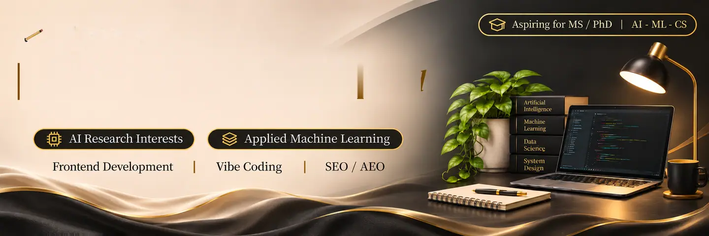
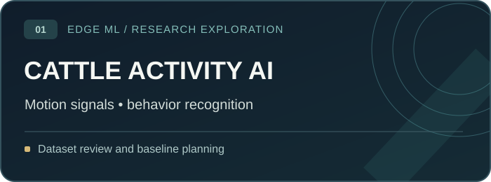
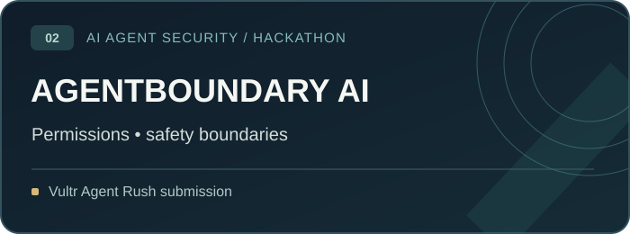
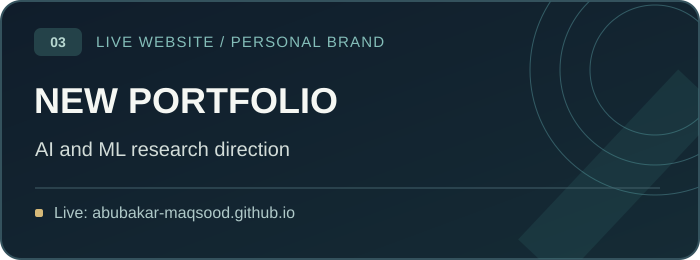
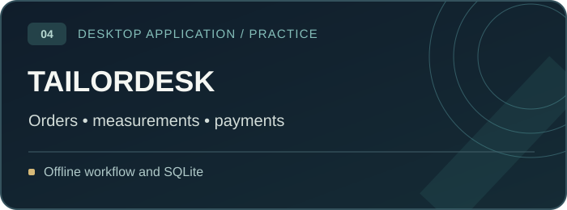

<!-- Profile refresh: 11 November 2026 | GitHub-safe HTML, GIF and SVG -->

  
    
  &nbsp;
  &nbsp;
  
    
  
   
  

## About Me

I'm **Muhammad Abubakar Maqsood**, a **BS Information Technology graduate** (2025, **CGPA 3.53/4.00**) exploring **machine learning, trustworthy AI and applied computer science**. My aim is to build the experimental foundations for research-focused **Master's study** and, eventually, a **PhD**.

I bring hands-on experience in **frontend development, Shopify and technical SEO**. I am learning to connect practical software work with better evaluation, reproducible experiments and honest reporting of limitations.

**Exploring:** AI agent security · Reliable ML evaluation · Data transparency · Edge AI for livestock activity · Responsible AI

## Selected Work

  
  
  
  

| Project | What it demonstrates | Current stage |
|:--|:--|:--|
| **Cattle Activity AI** | Exploring recognition of cattle behaviors from wearable motion signals, with future interest in lightweight edge deployment | **Research exploration / planning**, not a validated model or completed paper |
| **[AgentBoundary AI](https://github.com/abubakar-maqsood/AgentBoundary-AI)** | Agent permission boundaries and safer execution workflows, developed with *The Explorers* | **Hackathon submission / prototype** |
| **[My New Portfolio](https://abubakar-maqsood.github.io/)** | Public profile featuring research interests, selected projects and practical experience | **Live** |
| **TailorDesk** | Offline tailor-shop management, customer measurement history, order tracking and balances | **Desktop application project**; public source not linked |

*Earlier practice clones and older storefront projects are intentionally excluded from this featured list. This does not delete their repositories.*

## Tools I Work With

  
   
  

Practical work: frontend, Shopify/Liquid, SEO · Growing skills: Python, ML experiments, agent workflows, TypeScript and desktop applications

## GitHub Activity

  
   
  
   
  

### Contribution Snake

  <picture>
    <source media="(prefers-color-scheme: dark)" srcset="https://raw.githubusercontent.com/abubakar-maqsood/abubakar-maqsood/output/github-snake-dark.svg" />
    
  </picture>
   The snake appears after the included GitHub Action runs successfully for the first time.

## What I'm Learning

**Trustworthy AI:** Evidence, model limitations, hallucinations and responsible use of tools.  
**Applied ML:** Preprocessing, validation, error analysis and reproducible notebooks.  
**Edge AI:** Exploring methods for efficient cattle-activity classification from sensor signals.  
**Software:** User-focused workflows and maintainable frontend systems.

**Recent milestone:** Participated in the Vultr Agent Rush Hackathon with *The Explorers*, submitting AgentBoundary AI. Completed Coursera prompt-engineering coursework.

## Connect

  <a href="https://abubakar-maqsood.github.io/">Portfolio</a> ·
  <a href="https://www.linkedin.com/in/abu-ba-kar/">LinkedIn</a> ·
  <a href="https://github.com/abubakar-maqsood/AgentBoundary-AI">AgentBoundary AI</a>
    
  
   Building foundations in AI research, one documented experiment at a time.

