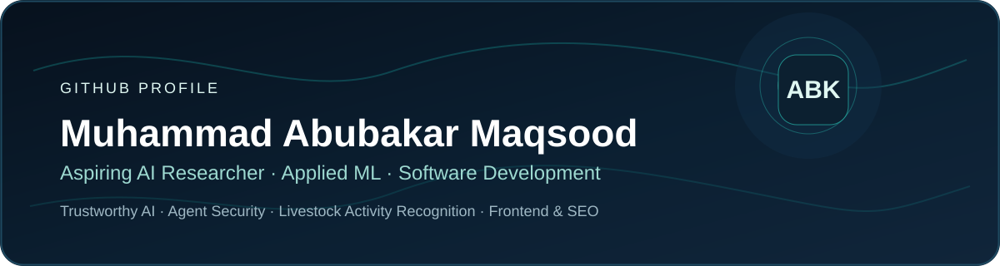
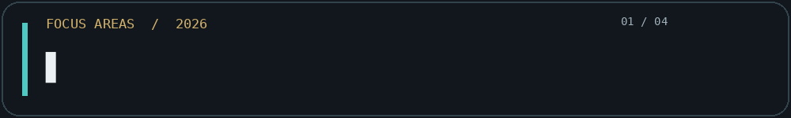
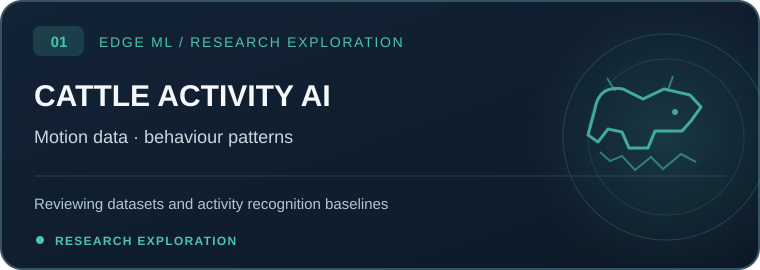
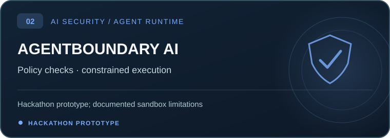
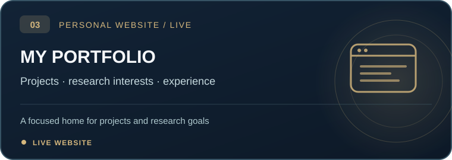
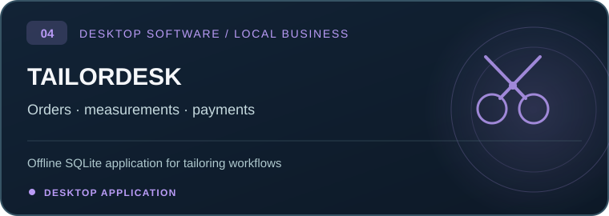
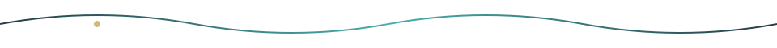
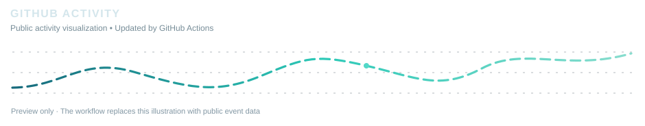
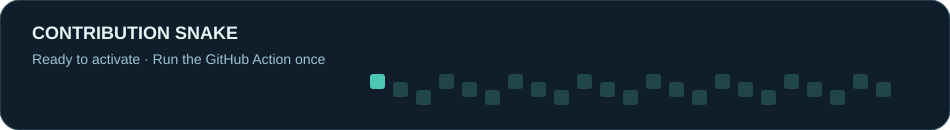

<!-- Self-contained polished GitHub profile package | November 2026 -->

  
    
  &nbsp;
  &nbsp;
  
    
  
    
  

## About Me

I'm **Muhammad Abubakar Maqsood**, an **Information Technology graduate** (2025, **CGPA 3.53/4.00**) building toward research in **applied machine learning, trustworthy AI, and AI systems**.

I combine practical experience in **frontend development, Shopify, and technical SEO** with ongoing study of Python, model evaluation, safer AI agents, and reproducible experimentation. I'm preparing for a research-focused **Master's** and, in the longer term, a **PhD**.

**Areas of interest:** AI agent security · Model reliability · Data transparency · Livestock activity recognition · Applied machine learning

## Selected Work

  
  
   
  
  

**Project status:** Cattle activity recognition is a research exploration, not a published model. AgentBoundary AI is a hackathon prototype; production-grade security and live Vultr deployment are not claimed. TailorDesk source is not linked publicly.

## Tools & Technologies

  
   
  
   
  Practical work: frontend, Shopify/Liquid, SEO · Developing skills: Python, applied ML, agent workflows, TypeScript, desktop applications

## GitHub Activity

  
   
  
    
  

### Contribution Snake

  <picture>
    <source media='(prefers-color-scheme: dark)' srcset='assets/2026-refresh/github-snake-dark.svg' />
    
  </picture>
   
  Cleaner preview included by default. If you run the workflow, the preview snake is replaced with the real generated contribution snake.

## What I'm Learning

**Trustworthy AI:** Reliable outputs, clear model limitations, verification and safer use of tools.  
**Applied ML:** Data cleaning, baselines, evaluation and error analysis.  
**Edge AI:** Exploring efficient cattle-behavior recognition from wearable motion data.  
**Software:** Clear workflows, offline applications and maintainable interfaces.

**Recent milestone:** Vultr Agent Rush Hackathon participation with **The Explorers**, submitting AgentBoundary AI; Coursera prompt engineering coursework.

## Let's Connect

  <a href='https://abubakar-maqsood.github.io/'>Portfolio</a> ·
  <a href='https://www.linkedin.com/in/abu-ba-kar/'>LinkedIn</a> ·
  <a href='https://github.com/abubakar-maqsood/AgentBoundary-AI'>AgentBoundary AI</a>
    
  
   Learning to build AI systems whose results can be explained, tested and trusted.

