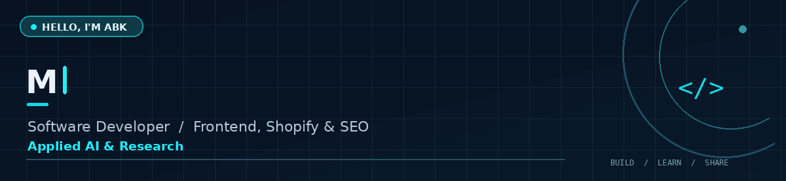
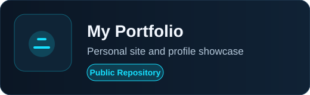
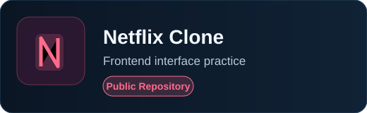
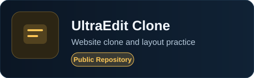
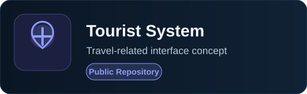
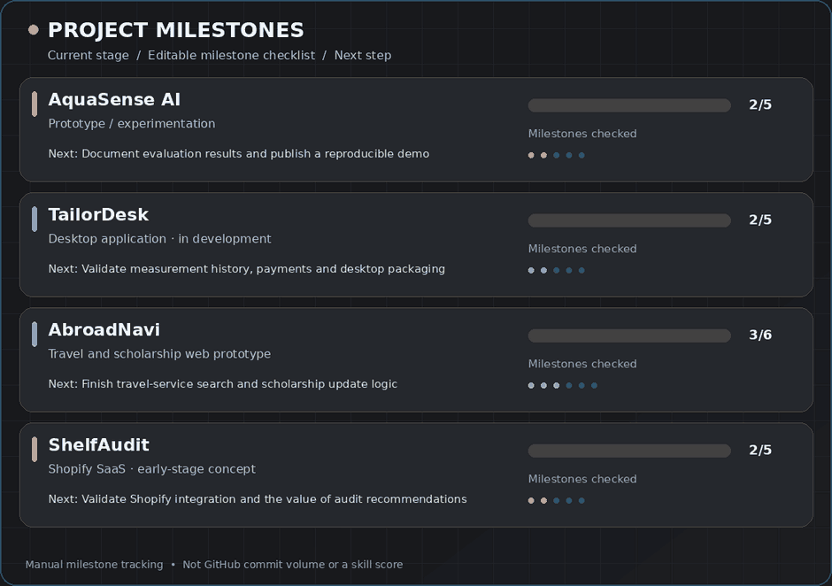

<!-- Profile repository: github.com/abubakar-maqsood/abubakar-maqsood -->
<div align="center">
  
  <br/><br/>
  <a href="https://www.linkedin.com/in/abu-ba-kar/"></a>
  <a href="https://ayhanpk.com/"></a>
  <a href="https://github.com/abubakar-maqsood?tab=repositories"></a>
</div>

<div align="center">
  <br/>
  
</div>

## About me

I'm **Muhammad Abubakar Maqsood**, a software developer focused on **frontend development, Shopify, and SEO**, with a growing interest in **applied AI and computer science research**. I enjoy building clean interfaces, solving real workflow problems, and exploring how software and AI can create useful outcomes.

**What I build**  
Responsive websites, e-commerce experiences, and software prototypes for real-world use cases.

**AI and research exploration**  
Learning Python, machine learning concepts, model evaluation, data reliability, and prompt engineering through practical experiments.

**Current projects**  
Developing software products and exploring questions in AI and computer science.

**Current activities**  
Taking part in AI hackathons and technical competitions, experimenting with ideas, and documenting what I learn.

**Experience**  
Web development and e-commerce work with **Fusion Funky**, alongside independent projects.

**Education**  
BS Information Technology, **University of Agriculture Faisalabad**, Sub-Campus Burewala (2025).

**Open to**  
Software engineering collaborations, open source, applied AI learning, and technical projects with practical impact.

## Tools and technologies

### Main focus

**Frontend:** HTML · CSS · JavaScript · Bootstrap · Tailwind CSS  
**E-commerce:** Shopify · Liquid · Store development and management  
**SEO and web quality:** Technical SEO · Responsive design · Performance and accessibility  
**Developer workflow:** Git · GitHub · VS Code · Debugging

<div align="center">
  
  <br/>
  
</div>

### Currently learning and exploring

The tools below are areas I'm learning or using in experiments; **they are not listed as professional specializations**.

| Software and data | AI and exploration |
|:--|:--|
| Python, Firebase, MySQL, SQLite, Electron | Machine learning concepts, model evaluation, data reliability |
| React, TypeScript (project-based learning) | Prompt engineering, AI-assisted development, research exploration |

## Completed projects

<div align="center">
  
  
  <br/>
  
  
</div>

These are my visible public repositories and practice projects. I prefer to improve their documentation and code quality over adding unnecessary demo links.

## Ongoing projects

These are prototypes and ongoing projects that represent what I'm currently building and learning from.

| Project | What I'm building | Stage |
|:--|:--|:--|
| **AquaSense AI** | Water-quality data experiments, missing observations, and prediction evaluation. | Notebook prototype / learning |
| **TailorDesk** | Desktop workflow for tailor orders, measurements, payment balances and deliveries. | In development |
| **AbroadNavi** | Travel-service information and scholarship discovery experience. | Web prototype |
| **ShelfAudit** | Shopify store auditing and actionable improvement insights. | Early-stage concept |

### Animated project tracker

<div align="center">
  
</div>

<details>
<summary><b>How project progress works</b></summary>

Each bar **animates from zero to the completed milestone fraction**, based on editable checkboxes in [`data/projects.json`](data/projects.json). The figures represent only those selected milestones. They are not skill scores, automated completion detection, or repository commit activity. A GitHub Actions workflow can regenerate the GIF and SVG when you update the JSON file. [See a static tracker image](assets/project-dashboard-still.png).
</details>

## Current focus

```text
01  Building real-world software and publishing clearer project documentation
02  Improving frontend development, Shopify workflows and technical SEO
03  Learning Python, machine learning and reliable model evaluation
04  Participating in hackathons and technical competitions
05  Sharing reproducible demos, lessons learned and project results
```

## GitHub activity

See my [public repositories](https://github.com/abubakar-maqsood?tab=repositories) and [GitHub contributions](https://github.com/abubakar-maqsood?tab=overview). I value readable code, clear documentation and real progress over inflated statistics.

## Journey

| Period | Milestone |
|:--|:--|
| **2025** | Graduated with a BS in Information Technology, UAF Sub-Campus Burewala. |
| **2025** | Web-development internships, including Hywiz Technologies. |
| **2025 – present** | Web/e-commerce experience, independent software projects and applied AI exploration. |

<div align="center">
  
  <br/>
  <sub>Thanks for visiting. Explore a project or connect with me on LinkedIn.</sub>
</div>
