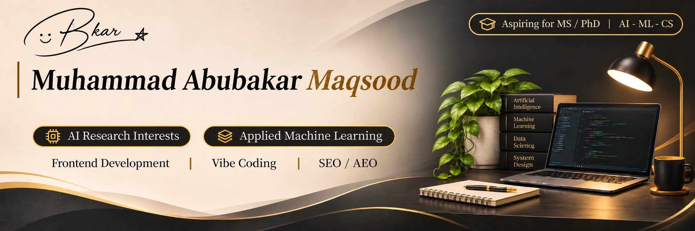
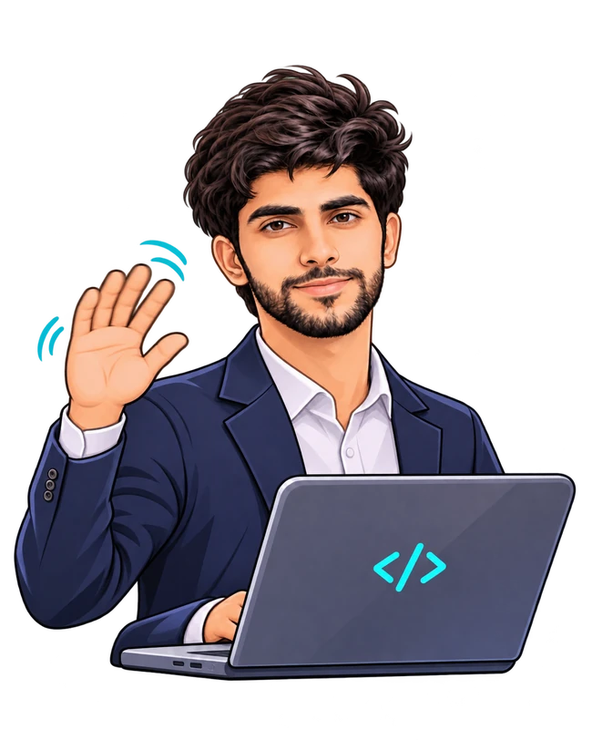

<!-- Profile repository: github.com/abubakar-maqsood/abubakar-maqsood -->

  
    
  
  
  
    
  
   
  

I'm **Muhammad Abubakar Maqsood**, an Information Technology graduate developing my interests in **AI research, applied machine learning, model evaluation, and data reliability**. I'm preparing myself for **future Master's and PhD study opportunities abroad** through practical experiments, project work, and research-oriented learning.

My professional background is in **software development, frontend engineering, Shopify, and SEO**. I want to connect practical software skills with clear, honest, and reproducible AI work.

**Research interests:** Trustworthy AI, applied machine learning, model evaluation, uncertainty, and responsible AI systems.  
**Current direction:** Learning through experiments, prototypes, hackathons, and structured self-study.  
**Academic background:** BS Information Technology, University of Agriculture Faisalabad, Sub-Campus Burewala (2025), CGPA **3.53/4.00**.  
**Professional experience:** Frontend and e-commerce work, including Fusion Funky.

## Research interests and experiments

| Area | Current focus |
|:--|:--|
| **Trustworthy AI** | Understanding when AI outputs should be trusted, verified, or questioned. |
| **Applied ML** | Practicing experiments with imperfect datasets and reproducible workflows. |
| **Model evaluation** | Learning how to evaluate errors, missing values, limitations, and reliability. |
| **AI agents** | Exploring accountability, consent, verification, and safer AI-assisted workflows. |

### AquaSense AI — Applied ML exploration

A practical learning project using water-quality data to explore preprocessing, missing-value analysis, basic prediction, and model evaluation. **AquaSense AI is a learning prototype**, not a published research paper or a deployed scientific system.

## Tools and technologies

  <b>Development foundation and current exploration</b>
    
  
   
  

**Professional focus:** Frontend development, Shopify, Liquid, responsive UI, technical SEO and web quality.  
**Currently learning or exploring:** Python, applied ML, React, TypeScript, Firebase, MySQL, SQLite, Electron, and prompt engineering. These are learning interests, not claims of professional specialization.

## Completed projects and public practice

The following public repositories demonstrate web development and frontend learning. Practice clones are labeled accordingly and are **not presented as original research**.

  
  
   
  

## Current software projects

| Project | Purpose | Stage |
|:--|:--|:--|
| **AquaSense AI** | Water-quality data preparation and ML evaluation experiments. | Notebook prototype |
| **TailorDesk** | Tailoring orders, measurements, payment balances and delivery workflow. | In development |
| **AbroadNavi** | Travel services and scholarship discovery. | Web prototype |
| **ShelfAudit** | Shopify store audit insights and improvement workflows. | Early-stage concept |

### Animated project milestones

  

<b>How the project tracker works</b>

The dashboard uses the manually maintained checklist in [`data/projects.json`](data/projects.json). The animation shows **listed milestones checked**, not an automated measurement of project completion, coding skill, or GitHub activity. Review starter milestones before using the numbers publicly.

## Graduate-study direction

My current goal is to strengthen my foundation in AI and software engineering through reproducible experimentation, honest documentation, and project-based learning. I am **looking forward to funded Master's opportunities and, in the long term, PhD study abroad**. My interests are still developing; I do not claim formal publications or established researcher status.

## Current activities

- Building and documenting software and applied ML prototypes.
- Participating in hackathons and technical competitions.
- Learning to evaluate AI systems with clearer evidence and limitations.
- Improving research and technical communication.

## GitHub and collaboration

View my [public repositories](https://github.com/abubakar-maqsood?tab=repositories) and [contribution activity](https://github.com/abubakar-maqsood?tab=overview). I value documented methodology, readable code, transparent limitations and useful collaboration.

  
   
  Building foundations in AI research, applied machine learning and software engineering.

